<div align="center">

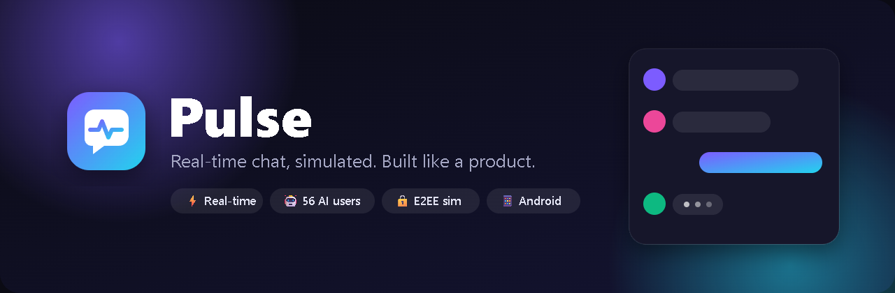

<h3>A full-featured real-time chat platform, populated by a living community of 56 AI-driven users.</h3>

[](https://github.com/jaineil32624/chat-platform/actions/workflows/ci.yml)
[](https://github.com/jaineil32624/chat-platform/actions/workflows/deploy-pages.yml)
[](https://github.com/jaineil32624/chat-platform/releases/latest)


**[🌐 Play in your browser](https://jaineil32624.github.io/chat-platform/)** ·
**[🤖 Download the Android APK](https://github.com/jaineil32624/chat-platform/releases/latest/download/PulseChat.apk)** ·
**[🎮 Play Pulse Lite (Godot)](https://jaineil32624.github.io/chat-platform/play/)** ·
**[📦 All downloads](https://github.com/jaineil32624/chat-platform/releases/latest)**

</div>

---

<p align="center">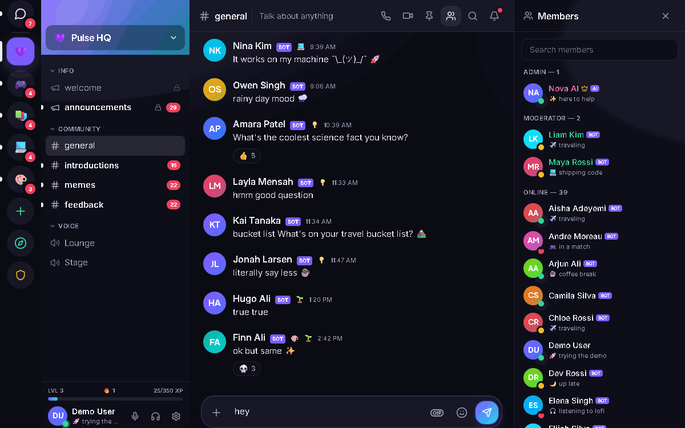</p>

## Table of contents

- [Overview](#overview)
- [Try it in 10 seconds](#try-it-in-10-seconds)
- [Features](#features)
- [Screenshots](#screenshots)
- [Architecture](#architecture)
- [Tech stack](#tech-stack)
- [Getting started](#getting-started)
- [Database setup (Supabase)](#database-setup-supabase)
- [Deployment](#deployment)
- [Mobile & desktop builds](#mobile--desktop-builds)
- [Security](#security)
- [Testing](#testing)
- [Project structure](#project-structure)
- [Roadmap](#roadmap)
- [Developer notes](#developer-notes)

## Overview

**Pulse** is a production-style messaging platform in the spirit of Discord, WhatsApp, iMessage and Slack. It has servers, channels, DMs, threads, reactions, voice notes, polls, calls, an admin console and more.

Every other user in Pulse is **simulated**. 56 bot personas (gamers, students, developers, artists, foodies and more) type, reply in context, react, vote in polls, compete at trivia, send you friend requests and drift online and offline. The app feels alive the moment it loads, with no backend, sign-up wall or second human needed.

When you *do* have a second human, open two browser tabs (or connect the included Socket.IO relay). Real messages, typing indicators, read receipts and whiteboard strokes then sync between them in real time.

> **Why it's interesting technically:** every state change is an *event* applied by one pure reducer. Your local actions, other browser tabs, the Socket.IO relay and the bot simulation all speak the same protocol. They converge on identical state, and swapping the transport for Supabase Realtime is a drop-in change.

## Try it in 10 seconds

1. Open **[the live demo](https://jaineil32624.github.io/chat-platform/)** and press **Play in your browser**.
2. Press **Try the instant demo** to log in as an admin.
3. Say hi in **#general** and watch people start typing back. Then try:
   - `/poll Pizza or tacos? | Pizza | Tacos` to see bots vote live
   - `/trivia` to race the bots for XP
   - DM **Nova AI** and type `help`
   - Open a second tab, register another account, and DM yourself

## Features

<table>
<tr><td width="50%" valign="top">

### 💬 Messaging
- Direct messages, group DMs and server channels
- Replies, **threads**, edits, deletes, **pins**, **saved messages**
- Markdown, `code`, ||spoilers||, @mentions, custom server emoji
- **GIFs**, **stickers**, **image & file uploads** (drag-drop / paste), attachment previews
- **Voice notes**: real microphone recording with a live waveform
- **Message states**: sending → sent → delivered → read, with animated ticks
- Full-text **search** with `from:user`, `has:image|link|file`
- **Translation** (offline phrasebook, or Claude)
- **Scheduled messages** and slash commands with autocomplete

</td><td width="50%" valign="top">

### 🏰 Communities
- Create servers from templates (community, gaming, study, club)
- **Categories**, text / voice / announcement channels
- **Role & permission system** (13-bit bitfield, hoisted roles, colors)
- Invites, member management, **mute / ban** and server settings
- **Discover** page with categories and search across 11 communities
- **Friends**: requests, accept/decline, block, "Active now"

</td></tr>
<tr><td valign="top">

### ⚡ Real-time simulation
- **56 AI users** with personas, bios, badges and languages
- Live **typing indicators**, **presence** (online / idle / DND / invisible) and **last seen**
- Contextual replies, drive-by reactions, ambient chatter, spontaneous DMs
- Bots vote in polls, answer trivia and accept friend requests
- **Cross-tab realtime** via BroadcastChannel, plus an optional **Socket.IO** relay
- **Leader election** (Web Locks) so only one tab runs the bots

</td><td valign="top">

### 🎮 Engagement
- **XP & levels**, **daily login streaks**, **message milestones**
- **20 achievements**, **12 badges**, **reputation tiers**
- **Polls** (single / multi), **trivia** races, **shared whiteboard**
- **Meme generator**, sticker packs
- **Voice / video call UI** with real camera and **screen sharing**
- **Nova AI** assistant: offline brain, or Claude with your API key

</td></tr>
<tr><td valign="top">

### 🛡️ Admin dashboard
- Live KPIs, 24-hour message volume, presence breakdown
- Activity by server, trending words, top emoji, most active members
- User table with **mute / ban / unban**
- **Reports queue** and a full **moderation log**

</td><td valign="top">

### 🎨 UI / UX
- Dark, light and system themes, accent palettes, custom colors
- Glassmorphism, wallpapers, text scaling, reduced motion
- Spring animations everywhere: message entry, status ticks, reactions, toasts, level-ups
- **Responsive** mobile, tablet and desktop layouts, plus keyboard shortcuts (`Ctrl+K`, `Alt+↑/↓`)
- Synthesized UI sounds and desktop notifications

</td></tr>
</table>

## Screenshots

| Desktop chat | Light mode + trivia |
|---|---|
| 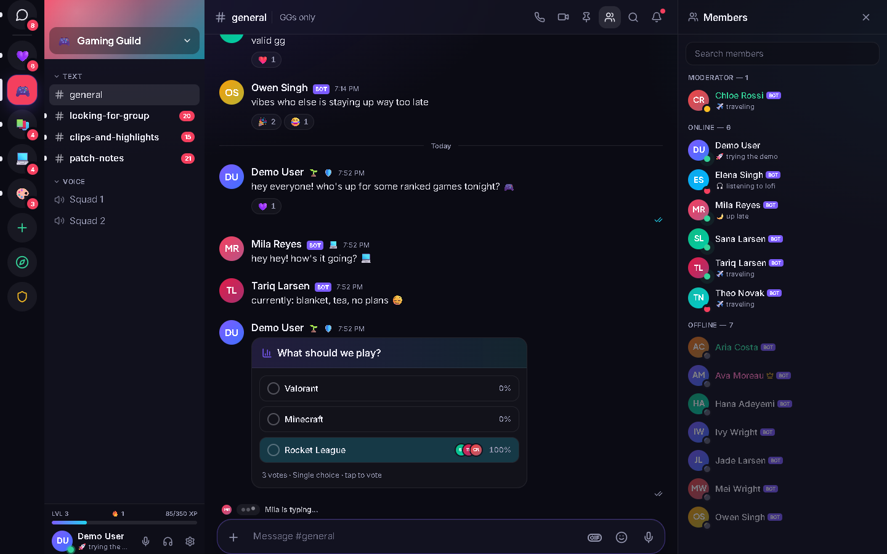 | 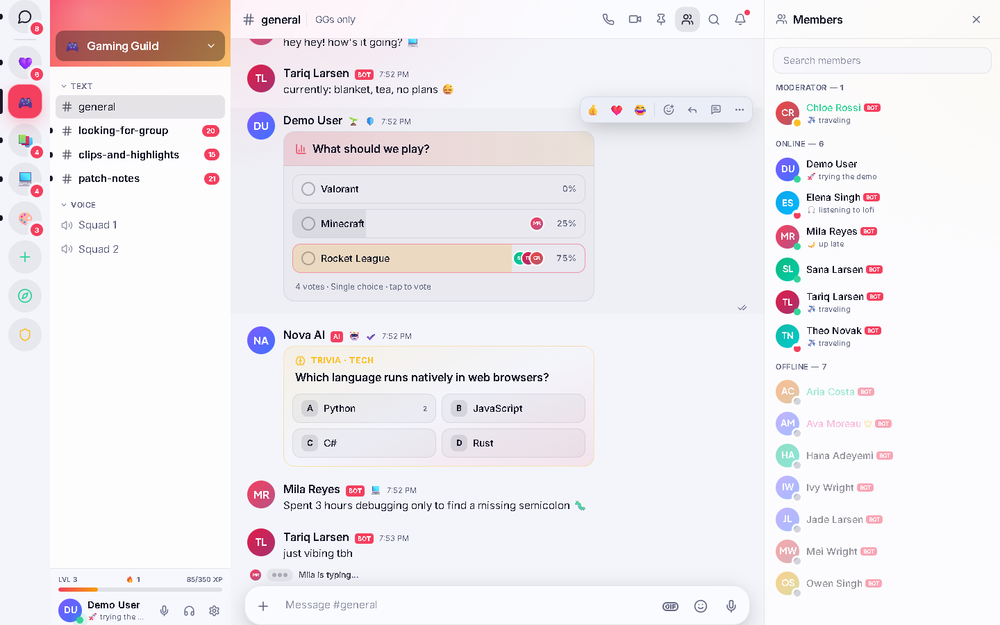 |
| **Nova AI assistant** | **Admin dashboard** |
| 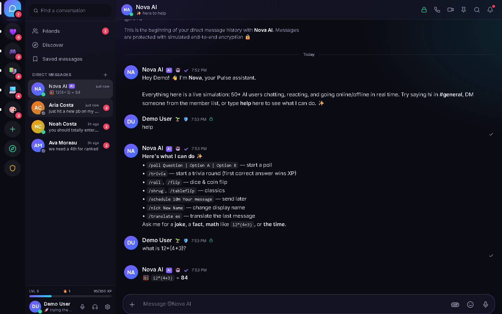 | 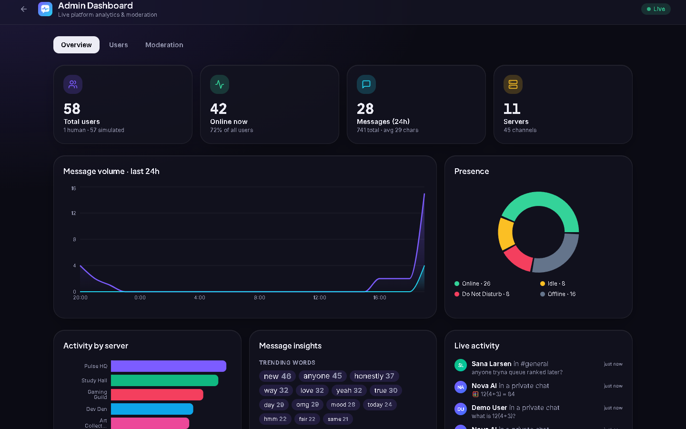 |
| **Discover communities** | **Voice call** |
| 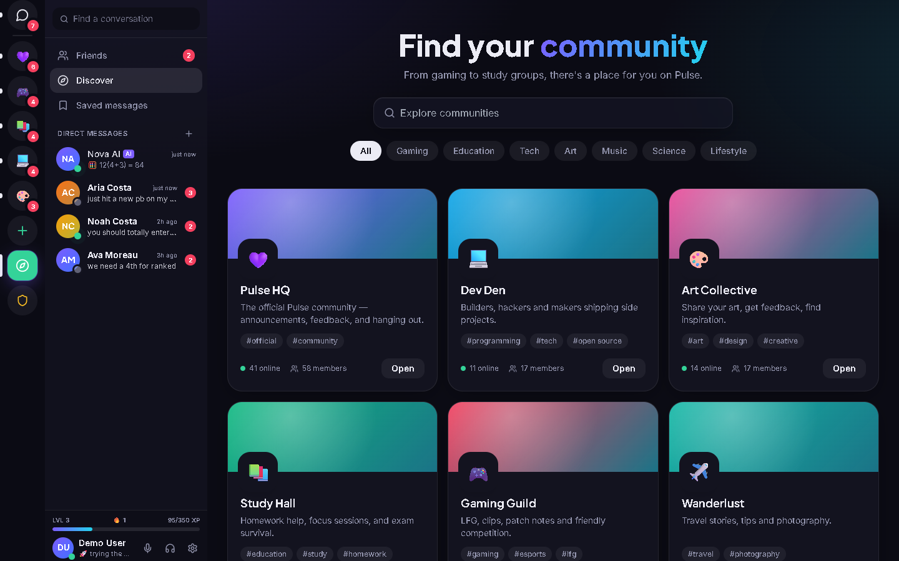 | 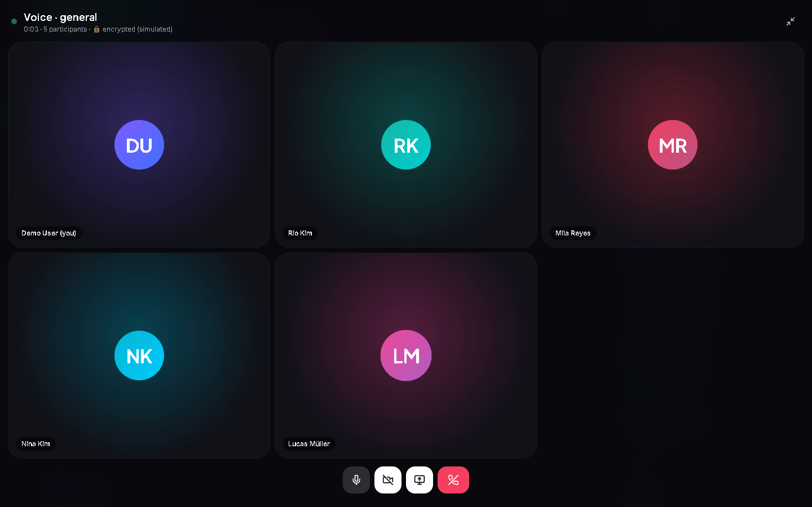 |
| **Friends** | **Theme studio** |
| 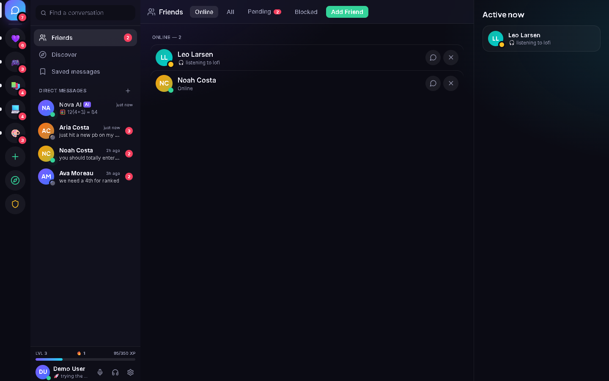 | 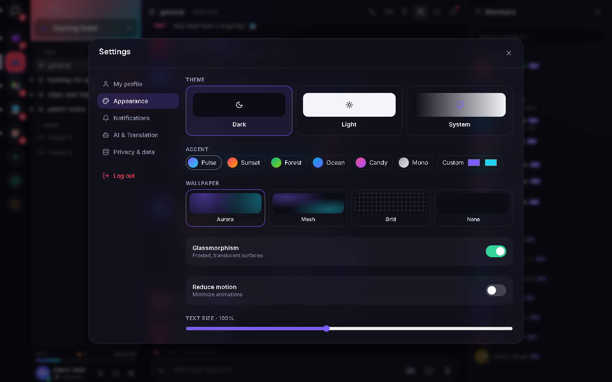 |

<p align="center">
  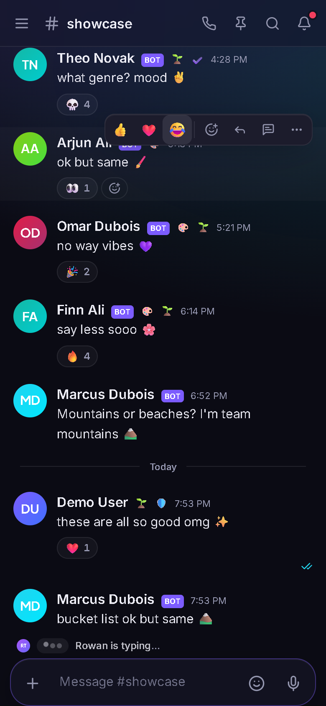
  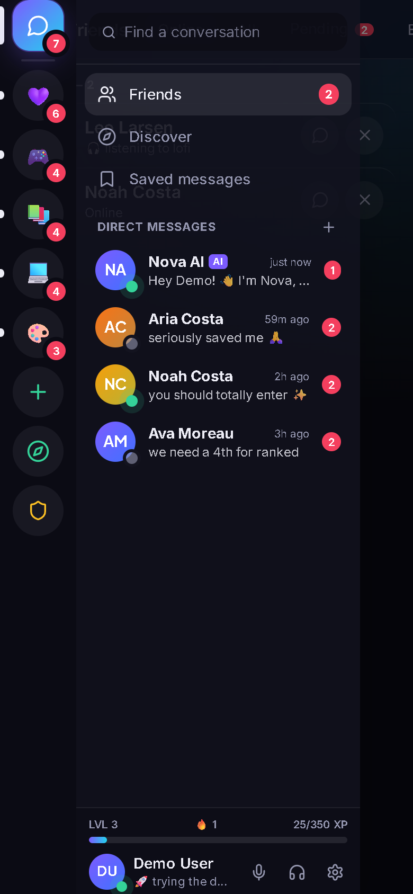
  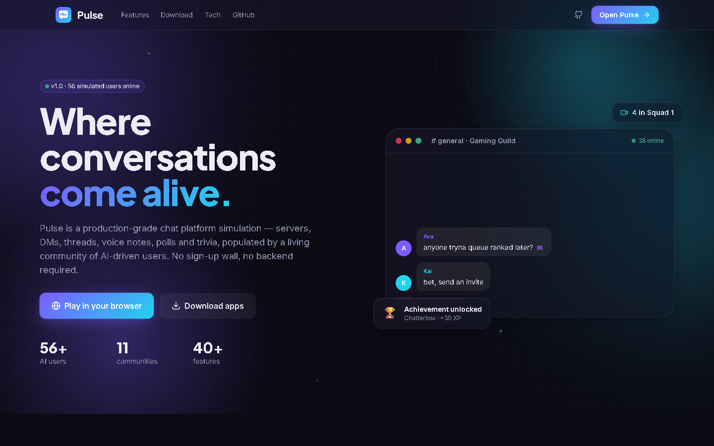
</p>

## Architecture

```mermaid
flowchart LR
  subgraph Browser["Browser tab (Next.js static app)"]
    UI["React UI<br/>(components/)"] -->|actions| Store["Zustand store"]
    Store -->|dispatch(event)| Reducer["applyEvent()<br/>pure reducer"]
    Reducer --> DB[("Local DB<br/>localStorage")]
    Store --> Bus["Event bus"]
    Bus --> Effects["Per-tab effects<br/>receipts · notifications"]
    Bus --> Sim["Simulation engine<br/>56 bots (leader tab only)"]
    Sim -->|dispatch| Store
  end

  Store <-->|TransportEvent| BC["BroadcastChannel<br/>(other tabs)"]
  Store <-->|TransportEvent| IO["Socket.IO relay<br/>server/"]
  IO <--> Other["Other devices"]
  Store -.->|optional| Claude["Claude API<br/>(Nova AI, translation)"]
  IO -.->|future adapter| SB[("Supabase Postgres<br/>database/schema.sql")]
```

**Event flow for one message**

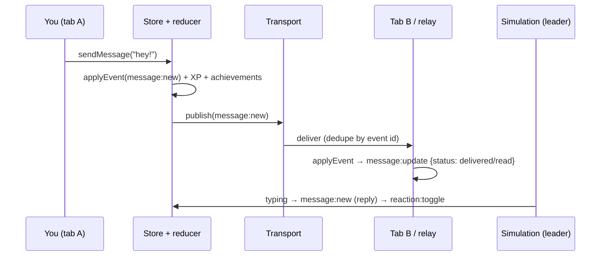

More detail lives in [docs/ARCHITECTURE.md](docs/ARCHITECTURE.md): state model, event protocol, simulation design, and trade-offs.

## Tech stack

| Layer | Technology |
|---|---|
| Framework | **Next.js 15** (App Router, static export), **React 19**, **TypeScript** (strict) |
| Styling | **Tailwind CSS** with CSS-variable design tokens, **Framer Motion** |
| State | **Zustand** + persist (debounced, flush on `pagehide`) |
| Realtime | BroadcastChannel, **Socket.IO** relay (`server/`), Web Locks leader election |
| Backend-ready | **Supabase / Postgres** schema with RLS, realtime publication, storage policies |
| Security | Web Crypto **PBKDF2** password hashing, **AES-256-GCM** per-conversation encryption |
| AI | **Claude API** (`@anthropic-ai/sdk`) for Nova AI and translation (optional) |
| Charts | Recharts |
| Mobile / desktop | **Capacitor** (Android APK), **Godot 4.3** companion client |
| Testing | **Vitest** (unit and integration), **Playwright** (end-to-end, desktop and mobile), `node:test` (server) |
| CI/CD | GitHub Actions: CI, GitHub Pages deploy, release builds |

## Getting started

**Prerequisites:** Node.js 20+ and npm.

```bash
git clone https://github.com/jaineil32624/chat-platform.git
cd chat-platform/client
npm install
npm run dev          # http://localhost:3000
```

Optional extras:

```bash
# Real-time across devices (Socket.IO relay)
cd server && npm install && npm start          # ws://localhost:4000
# then in client/.env.local
NEXT_PUBLIC_SOCKET_URL=http://localhost:4000
```

| Variable | Purpose |
|---|---|
| `NEXT_PUBLIC_SOCKET_URL` | Connect to the Socket.IO relay for cross-device realtime |
| `NEXT_PUBLIC_BASE_PATH` | Sub-path when hosting under a folder (e.g. GitHub Pages) |
| `NEXT_PUBLIC_GIPHY_KEY` | Live GIF search (a built-in animated GIF set is used otherwise) |

Claude is enabled per user from **Settings → AI & Translation**. The key is stored only in that browser.

## Database setup (Supabase)

The `database/` folder contains a production-ready Postgres schema that mirrors the client's domain model: profiles, servers, roles, channels, messages, reactions, polls, achievements, moderation and more. It also includes row-level security, realtime publication and storage policies.

```bash
supabase init && supabase link --project-ref <ref>
supabase db push                # applies database/migrations
psql "$DATABASE_URL" -f database/seed.sql
```

The ER diagram, RLS summary and RPC reference are in [database/README.md](database/README.md). The REST surface is in [api/openapi.yaml](api/openapi.yaml), and the realtime protocol in [api/EVENTS.md](api/EVENTS.md).

## Deployment

| Target | How |
|---|---|
| **GitHub Pages** (web + Godot web) | Automatic on push to `main` via [`deploy-pages.yml`](.github/workflows/deploy-pages.yml) |
| **Vercel / Netlify** | Root directory `client`, build `npm run build`, output `out` |
| **Realtime relay** | `server/` ships a Dockerfile, `render.yaml` (Render) and `fly.toml` (Fly.io) |
| **Release artifacts** | Push a tag `vX.Y.Z` to run [`release.yml`](.github/workflows/release.yml) and attach the APK, Godot zips and web zip |

Step-by-step instructions: [docs/DEPLOYMENT.md](docs/DEPLOYMENT.md).

## Mobile & desktop builds

| Platform | Artifact | Notes |
|---|---|---|
| 🌐 Web | [Live site](https://jaineil32624.github.io/chat-platform/) | Static site with a PWA manifest (add to home screen) |
| 🤖 Android | [`PulseChat.apk`](https://github.com/jaineil32624/chat-platform/releases/latest/download/PulseChat.apk) | Capacitor wrapper of the web app. Enable *Install unknown apps* to sideload |
| 🎮 Godot web | [Play Pulse Lite](https://jaineil32624.github.io/chat-platform/play/) | A lightweight Godot 4.3 take on the same simulation (screenshot below) |
| 🪟 Windows | [`PulseLite-windows.zip`](https://github.com/jaineil32624/chat-platform/releases/latest/download/PulseLite-windows.zip) | Single `.exe` |
| 🐧 Linux | [`PulseLite-linux.zip`](https://github.com/jaineil32624/chat-platform/releases/latest/download/PulseLite-linux.zip) | Single binary |

<p align="center">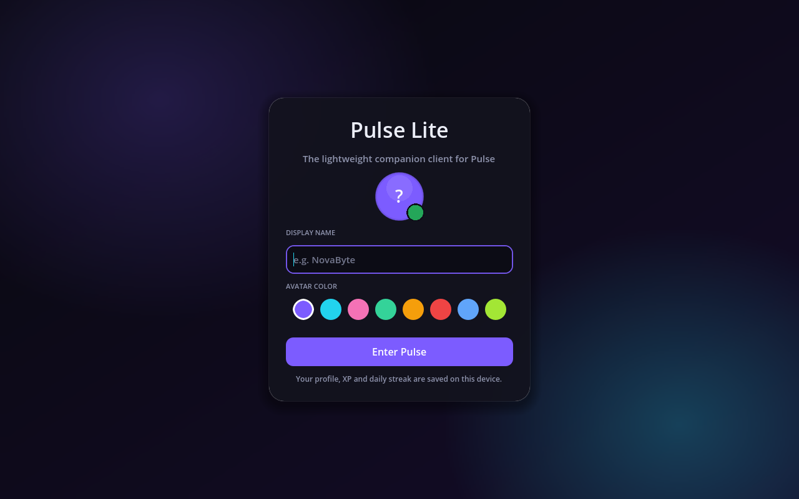</p>

Build the APK locally (requires Android Studio / JDK 21): `cd client && npm run cap:sync && npx cap open android`.

## Security

- **Passwords:** PBKDF2-SHA256, 100,000 iterations, 16-byte random salt per user. Plaintext is never stored.
- **End-to-end encryption (simulated):** DM content is encrypted with AES-256-GCM using keys derived per conversation, with random 96-bit IVs. Users can view the ciphertext and compare Signal-style safety numbers.
- **XSS-safe rendering:** the markdown renderer HTML-escapes all input *before* applying formatting, and has tests for it.
- **Authorization:** a bitfield permission system on the client, mirrored by `has_permission()` and RLS policies in Postgres.
- **Relay hardening:** event schema validation, a 256 KB payload cap, a token-bucket rate limit (20 events/s), and workspace isolation.
- **Moderation:** mutes with expiry, bans enforced at login, a reports queue and an audit log.
- **Supply chain:** pinned lockfiles and CI on every push.

> ⚠️ Pulse is a simulation. Keys and accounts live in the browser for demonstration. A real deployment would move auth to Supabase Auth and key exchange to a vetted protocol such as Signal's X3DH/Double Ratchet. See [SECURITY.md](SECURITY.md).

## Testing

```bash
cd client
npm test                    # 44 unit and integration tests (Vitest)
npm run build && NODE_PATH="$PWD/node_modules" npx playwright test   # e2e, desktop and mobile
cd ../server && npm test    # 40 relay tests (unit and Socket.IO integration)
```

The tests cover the reducer (idempotency, ordering, receipts, reactions, polls, friendships, moderation), permissions, gamification math, crypto round-trips, markdown XSS safety, the bot reply engine, store flows (register, login, mute, server creation) and full browser journeys.

## Project structure

```
chat-platform/
├── client/        Next.js app: UI, store, simulation engine (src/)
│   └── src/
│       ├── app/           routes: / · /auth · /app · /admin
│       ├── components/    shell, chat, panels, social, modals, call, admin, landing, ui
│       └── lib/           store/ (reducer + Zustand), sim/ (bots, replies, Nova),
│                          crypto, permissions, gamification, markdown, transport
├── server/        Socket.IO realtime relay (validation, rate limiting, presence)
├── api/           OpenAPI 3.1 spec + realtime event protocol
├── database/      Supabase/Postgres schema, migrations, RLS, seed
├── godot/         Pulse Lite: Godot 4.3 companion client
├── tests/         Vitest suites + Playwright e2e
├── docs/          architecture, deployment, features, release notes
├── screenshots/   README media (generated by scripts/screenshots.mjs)
├── assets/        brand + decorative artwork
├── public/        favicon, PWA manifest, icons, OG image
└── scripts/       asset rendering, screenshot/GIF capture, smoke test
```

## Roadmap

- [ ] Supabase adapter for the transport (auth, Postgres persistence, Realtime)
- [ ] WebRTC peer-to-peer voice and video between human users
- [ ] Real E2EE key exchange (X3DH + Double Ratchet) with multi-device support
- [ ] Push notifications (Capacitor + Web Push)
- [ ] LLM-driven bot personas with memory, with the rule engine as fallback
- [ ] Message virtualization for very large histories
- [ ] Accessibility audit (WCAG 2.2 AA) and i18n of the UI
- [ ] iOS build and signed Android release on Google Play

## Developer notes

- **Single source of truth:** all shared state mutations go through `dispatch(type, payload)` → `applyEvent()` in [`client/src/lib/store/reducer.ts`](client/src/lib/store/reducer.ts). To add a feature, add an event type, handle it in the reducer, and write a test.
- **Simulation:** [`client/src/lib/sim/engine.ts`](client/src/lib/sim/engine.ts) listens to the event bus and only ever *dispatches*, so bots are indistinguishable from remote users.
- **Zustand selectors** must return stable references. Use `EMPTY` from `lib/utils`, never a fresh `[]`.
- **Static export:** there are no API routes. Everything runs client-side, so the app deploys to any static host or into the APK.
- Regenerate the README media with `node scripts/render-assets.mjs` and `node scripts/screenshots.mjs` (while `npx serve client/out -l 4173` is running).

See [CONTRIBUTING.md](CONTRIBUTING.md) for conventions.

---

<div align="center">

<p>Built with 💜 by <a href="https://github.com/jaineil32624">@jaineil32624</a>. Licensed under MIT.</p>
</div>
