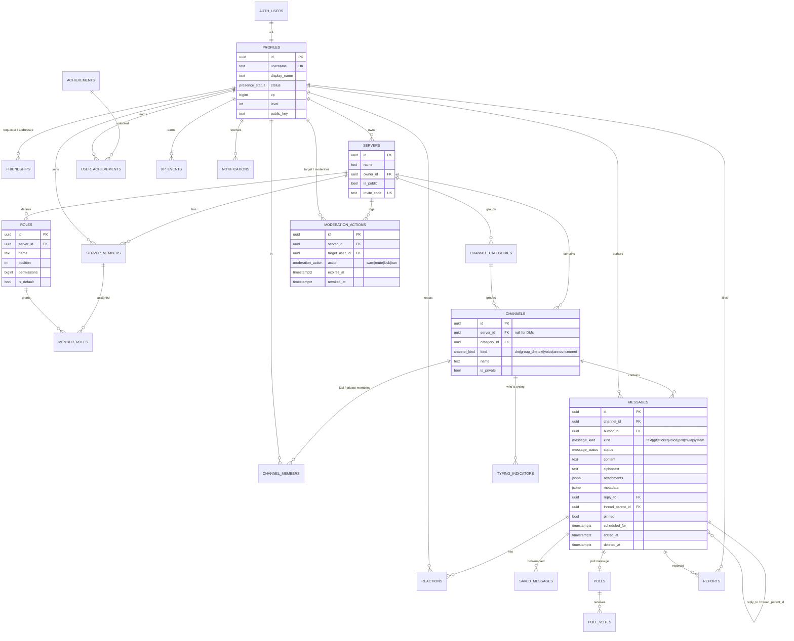

# Pulse database (Supabase / Postgres)

This folder defines everything Pulse persists: tables, constraints, triggers, row-level security, RPC functions, storage buckets and the realtime publication.

| File | Purpose |
| --- | --- |
| `schema.sql` | Full schema. Apply it once to a fresh project. |
| `migrations/0001_init.sql` | Byte-for-byte the same as `schema.sql`, laid out for the Supabase CLI. |
| `seed.sql` | Demo users, servers, channels, messages, a poll, achievements and moderation data. Safe to re-run. |

> If you change `schema.sql`, add a new `migrations/000N_*.sql` for the change. Do not edit `0001_init.sql` after it has been applied anywhere.

## Setup

### Option A: Supabase CLI (local Docker stack)

```bash
npm i -g supabase            # or: brew install supabase/tap/supabase
supabase init                # once, at the repo root (creates supabase/)
# Point the CLI at this folder's files:
cp database/migrations/*.sql supabase/migrations/
cp database/seed.sql supabase/seed.sql
supabase start               # Postgres, Auth, Realtime, Storage, Studio
supabase db reset            # applies migrations, then seed.sql
```

Studio runs at <http://localhost:54323>. Run `supabase status` to get the API URL and the anon and service keys for the client's `.env.local`:

```
NEXT_PUBLIC_SUPABASE_URL=http://127.0.0.1:54321
NEXT_PUBLIC_SUPABASE_ANON_KEY=<anon key>
```

To push to a hosted project:

```bash
supabase link --project-ref <ref>
supabase db push                       # applies supabase/migrations
psql "$DATABASE_URL" -f database/seed.sql   # optional demo data
```

### Option B: Supabase dashboard

1. Create a project at <https://supabase.com/dashboard>.
2. Open **SQL Editor → New query**, paste `schema.sql`, and run it. The file is wrapped in a single transaction, so it either applies completely or not at all.
3. Optionally paste `seed.sql` and run it.
4. Under **Database → Publications → supabase_realtime**, check that `messages`, `reactions`, `typing_indicators`, `notifications` and `poll_votes` are enabled. The schema adds them.
5. Under **Storage**, confirm the `attachments` (private) and `avatars` (public) buckets exist.
6. Optional: under **Database → Extensions**, enable `pg_cron` and schedule the maintenance jobs:

   ```sql
   select cron.schedule('publish-scheduled', '* * * * *', 'select public.publish_due_scheduled_messages()');
   select cron.schedule('prune-typing',      '* * * * *', 'select public.prune_typing_indicators()');
   ```

### Demo accounts (from `seed.sql`)

| Email | Password | Role |
| --- | --- | --- |
| `alice@pulse.dev` | `password123` | Owner of *Pulse HQ* and *Game Night* |
| `bob@pulse.dev` | `password123` | Moderator in *Pulse HQ* |
| `carol@pulse.dev` | `password123` | Member (Supporter role) |
| `dave@pulse.dev` | `password123` | Member, muted for one hour |

Invite codes: `pulse-hq` and `game-night`.

## Permissions

`roles.permissions` is a `bigint` bitfield. A member's effective permissions are the bitwise OR of the `@everyone` role (`is_default`) and every role assigned to them. The server owner, and anyone holding `ADMINISTRATOR`, resolves to all bits (`8191`).

| Bit | Name | Bit | Name |
| ---: | --- | ---: | --- |
| 1 | `VIEW_CHANNEL` | 128 | `MANAGE_ROLES` |
| 2 | `SEND_MESSAGES` | 256 | `MENTION_EVERYONE` |
| 4 | `MANAGE_MESSAGES` | 512 | `ATTACH_FILES` |
| 8 | `MANAGE_CHANNELS` | 1024 | `ADD_REACTIONS` |
| 16 | `KICK_MEMBERS` | 2048 | `PIN_MESSAGES` |
| 32 | `BAN_MEMBERS` | 4096 | `ADMINISTRATOR` |
| 64 | `MUTE_MEMBERS` | | |

The same table is stored as `public.permissions`, so it can be queried. New servers get `@everyone = VIEW | SEND | ATTACH | REACT = 1539`.

### Helper functions (all `security definer`)

| Function | Returns |
| --- | --- |
| `has_permission(server, perm)` | Whether the **current user** (`auth.uid()`) holds every bit in `perm` |
| `has_permission(server, user, perm)` | Same check for an explicit user |
| `member_permissions(server, user)` | Effective bitfield |
| `channel_has_permission(channel, perm)` | Channel-aware check: DM membership, private channels |
| `can_view_channel(channel)`, `can_send_message(channel)` | Used by policies. `can_send_message` also accounts for mutes, announcement channels and DM blocks |
| `is_server_member(server)`, `is_moderator(server)`, `has_active_sanction(server, user, action)` | |

## Row-level security, in short

RLS is enabled on every table.

- **Messages:** you can read messages in channels you can view. A scheduled message is visible only to its author until it is published. Only the author can edit the body. `MANAGE_MESSAGES` lets someone soft-delete (`deleted_at`) other people's messages, and soft-deleting scrubs the content. `PIN_MESSAGES` lets someone pin. A trigger (`guard_message_update`) enforces these rules field by field.
- **Sending** requires `SEND_MESSAGES`. The sender must also not be muted. Announcement channels additionally require `MANAGE_MESSAGES`. Attachments require `ATTACH_FILES`, and `mention_everyone` requires `MENTION_EVERYONE`. In a 1:1 DM, sending is refused if either side has blocked the other.
- **Servers and roles:** members can read the roster and roles. `MANAGE_ROLES` lets a member edit roles and assign them, but only an administrator can grant `ADMINISTRATOR`. `MANAGE_CHANNELS` covers channels and categories. The owner cannot leave the server.
- **Moderation:** `warn` needs any moderation permission. `mute` needs `MUTE_MEMBERS`, `kick` needs `KICK_MEMBERS` and `ban` needs `BAN_MEMBERS`. Kicks and bans remove the member. Nobody can moderate the owner, and only the owner can moderate administrators. Banned users cannot rejoin.
- **Friends:** only the addressee can accept a request. Use `block_user()` to block someone. The blocked user cannot see the block row.
- **Gamification:** `achievements`, `user_achievements` and `xp_events` are read-only for clients. The service role or triggers write them, and a trigger keeps `profiles.xp` and `level` in sync (`level = floor(sqrt(xp/100)) + 1`).
- **Notifications** are created by triggers for replies, mentions, friend requests, moderation actions and achievements. Each user can read, mark and delete only their own.

## RPC functions (`supabase.rpc(...)`)

| Function | Notes |
| --- | --- |
| `join_server_by_invite(p_code)` → `uuid` | Refuses banned users |
| `create_dm(p_other)` → `uuid` | Finds the existing 1:1 DM or creates one |
| `create_group_dm(p_members uuid[], p_name)` → `uuid` | 2 to 10 members |
| `block_user(p_target)` | |
| `toggle_reaction(p_message, p_emoji)` → `boolean` | `true` means added |
| `search_messages(p_query, p_server, p_channel, p_author, p_has, p_before, p_after, p_limit, p_offset)` | Full-text search with `websearch_to_tsquery`. Subject to RLS |
| `get_poll_results(p_poll)` | Counts only, so anonymous polls stay anonymous |
| `get_server_analytics(p_server, p_days)` | Daily messages, active users, new members and reactions. `ADMINISTRATOR` only |
| `publish_due_scheduled_messages()`, `prune_typing_indicators()` | Service role or pg_cron only |

## Realtime

The schema runs the equivalent of:

```sql
alter publication supabase_realtime add table
  public.messages, public.reactions, public.typing_indicators, public.notifications, public.poll_votes;
```

Each table is added only if it is not already in the publication. `messages`, `reactions` and `typing_indicators` use `REPLICA IDENTITY FULL`, so UPDATE and DELETE payloads carry `channel_id` and can be filtered:

```ts
supabase.channel(`room:${channelId}`)
  .on('postgres_changes', { event: '*', schema: 'public', table: 'messages', filter: `channel_id=eq.${channelId}` }, onChange)
  .subscribe();
```

Realtime enforces the `select` policies, so subscribers only receive rows they are allowed to read.

> The Socket.IO relay in `server/` is a separate, database-free transport used by the simulation. The two can run side by side.

## Storage

| Bucket | Public | Max size | Path convention | Policy |
| --- | --- | --- | --- | --- |
| `attachments` | no | 25 MiB | `{channel_id}/{user_id}/{uuid}-{filename}` | Readable by anyone who can view the channel. Uploads only to your own `{user_id}` folder, and only in channels where you can send with `ATTACH_FILES` |
| `avatars` | yes | 5 MiB | `{user_id}/{filename}` | Anyone can read. Only the owner can write |

Attachments are private, so the client should fetch them with `supabase.storage.from('attachments').createSignedUrl(path, 3600)`.

`messages.attachments` holds a JSON array of up to 10 items:

```json
[{ "id": "att_1", "name": "logo.png", "url": "<storage path>", "contentType": "image/png", "size": 48213, "width": 512, "height": 512 }]
```

## ER diagram



## Validation

The schema, seed and a set of RLS and trigger assertions were run on Postgres 16 (PGlite) with stubbed `auth` and `storage` schemas. The assertions checked:

- the permission math
- private channel and DM isolation
- hiding scheduled messages
- author-only edits
- moderator soft-delete and pin
- mute blocking sends
- the rule that kick is not ban
- owner protection
- ban blocking rejoin
- single-choice polls
- search respecting RLS
- the analytics permission check
- re-running the seed
