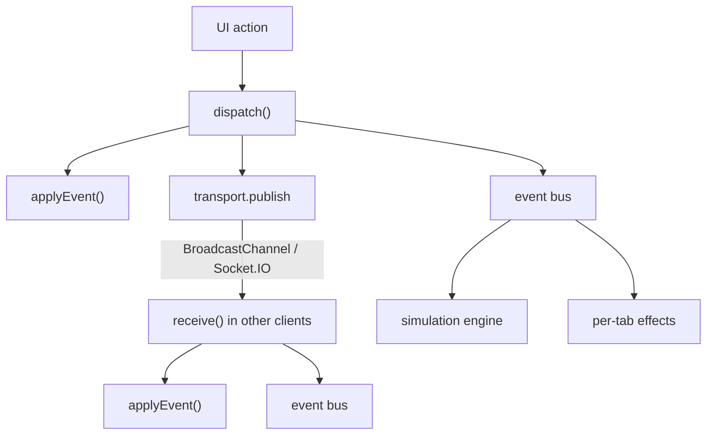

# Architecture

Pulse is a static Next.js application that behaves like a networked chat product. This document explains how the pieces fit together, and why.

## Goals that shaped the design

1. **Feel alive with zero infrastructure.** The app must work from a static host, an APK or `file://`, with no server.
2. **Behave like a real distributed system.** Two tabs, or two devices through the relay, must converge on the same state.
3. **Stay swappable.** The same UI should run on top of Supabase Realtime later without a rewrite.

## Event-sourced state

All shared state lives in a single `DB` object (`client/src/lib/store/reducer.ts`). It is never mutated directly. Every change is a `TransportEvent`:

```ts
interface TransportEvent<T = unknown> {
  id: string;          // unique; used for de-duplication
  type: TransportEventType;
  payload: T;
  origin: string;      // client id of the sender
  ts: number;
}
```

`applyEvent(db, event)` is a **pure function** that returns a new `DB` with structural sharing. Its properties:

| Property | How |
|---|---|
| Idempotent | `message:new` ignores ids it has already seen; transports de-dupe event ids |
| Order-tolerant | Out-of-order messages are re-sorted by `createdAt` |
| Monotonic receipts | `sending → sent → delivered → read` never moves backwards |
| Bounded | At most 400 messages per channel and 800 whiteboard strokes |

The store's `dispatch(type, payload)` applies the event locally, publishes it to the transport and notifies the event bus. `receive(event)` applies remote events and notifies the bus. Typing indicators are the one ephemeral exception: they live in UI state with a 6-second auto-expiry.



## Transports

`client/src/lib/transport.ts` exposes one interface:

```ts
interface Transport { publish(ev); subscribe(handler); connect({ userId }); close(); }
```

- **BroadcastChannel** (always on) syncs browser tabs on the same origin.
- **Socket.IO** (when `NEXT_PUBLIC_SOCKET_URL` is set) relays events to other devices. Events received from the socket are re-broadcast to sibling tabs.
- A **Supabase** adapter would subscribe to Postgres changes and publish via RPC. The event names already map to tables (see `api/EVENTS.md`).

## Sessions across tabs

The DB persists to `localStorage` (shared by all tabs). The *session* (which user is logged in) is kept per tab in `sessionStorage`, with `localStorage` as a remember-me fallback. That is what lets two tabs be two different people.

Persistence is debounced by 400 ms for performance and flushed on `pagehide`, so a reload never loses the last write.

## The simulation engine

`client/src/lib/sim/engine.ts` makes 56 bots behave like people:

- **Leader election.** `navigator.locks.request("pulse-sim-leader")` guarantees exactly one tab runs the bots. When that tab closes, another takes over automatically.
- **Reactive behavior.** It subscribes to the event bus. When a human posts, it schedules delivery and read receipts, contextual replies (DMs always, channels about 75% of the time, mentions always), drive-by reactions, poll votes and trivia answers.
- **Ambient behavior.** Randomized loops produce chatter (biased toward the channel you're viewing), presence churn, occasional DMs and friend requests.
- **Human-like timing.** Typing duration scales with message length. Idle bots take longer, and offline or DND bots may come online before answering.
- **Same protocol.** Bots only ever call `dispatch()`, so their activity crosses tabs and the relay exactly like a human's.

Replies come from `sim/replies.ts`: intent detection (13 intents), persona-specific pools, and a `voice()` pass that applies casing, slang and emoji habits. Each of the 12 personas has its own openers, bios and badges.

## Nova AI

`sim/assistant.ts` has an **offline brain**: help, a safe arithmetic parser (no `eval`), jokes, facts, date and time, and feature explanations. When the user saves a Claude API key, Nova calls the Messages API directly from the browser with the user's own key and a server-side refusal fallback. Failures degrade gracefully back to offline mode.

## Rendering

- **Message list:** grouping (same author within 5 minutes), day dividers, a "NEW" marker from a read-state snapshot taken before opening, auto-stick to bottom (with a `ResizeObserver` for late-loading media), and paging upwards by 60.
- **Markdown:** escape first, then transform, with placeholders for code so nothing inside it is formatted.
- **Performance:** components subscribe to narrow store slices, list items are memoized, and selectors return stable references.

## Data model ↔ database

`client/src/lib/types.ts` mirrors `database/schema.sql` one-to-one (snake_case in SQL, camelCase in TS). The permission bitfield values are identical in `lib/permissions.ts` and the `public.permissions` table, so moving the authority to Postgres RLS needs no translation layer.

## Trade-offs

| Decision | Why | Cost |
|---|---|---|
| Static export, client-only | Free hosting, APK packaging, instant demo | No server-side secrets; the Claude key is user-provided |
| `localStorage` persistence | Zero setup | About 5 MB quota, so images are compressed and history capped |
| Rule-based bots | Deterministic, free, offline | Less nuanced than LLM personas (on the roadmap) |
| Simulated E2EE | Demonstrates the real primitives | Keys are derived, not exchanged; not a security boundary |
